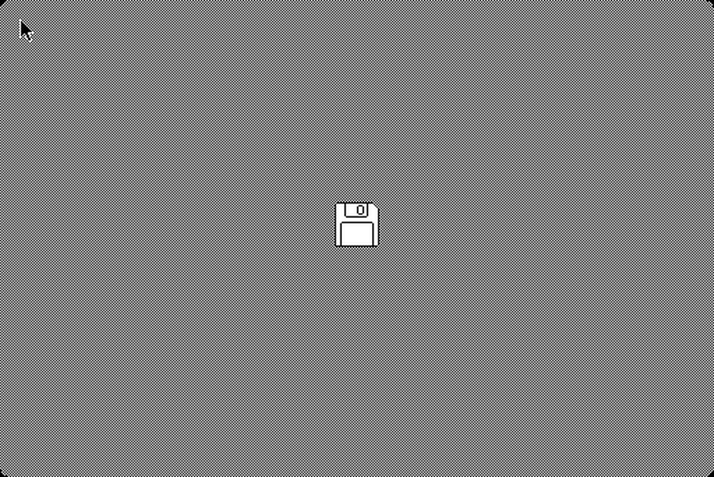
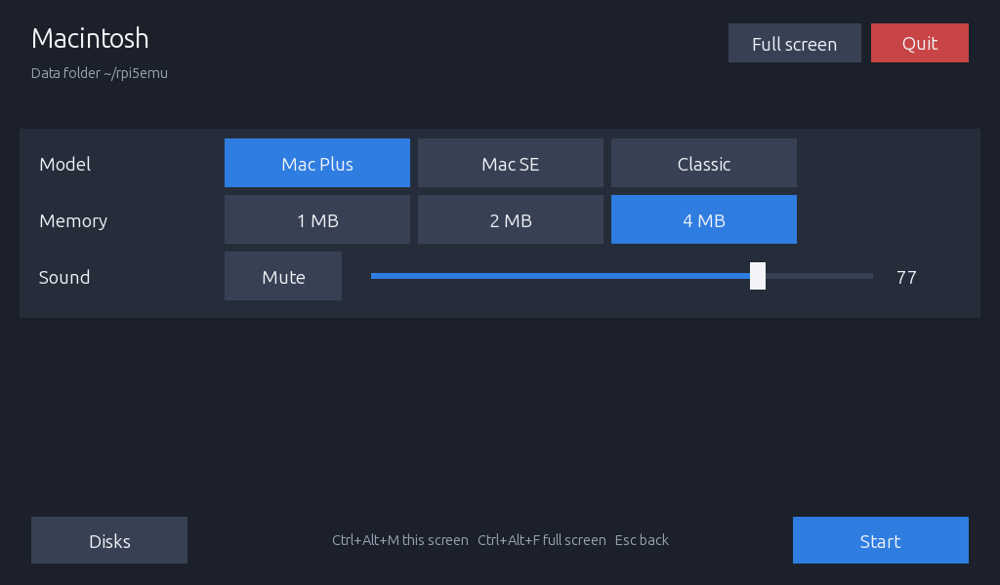
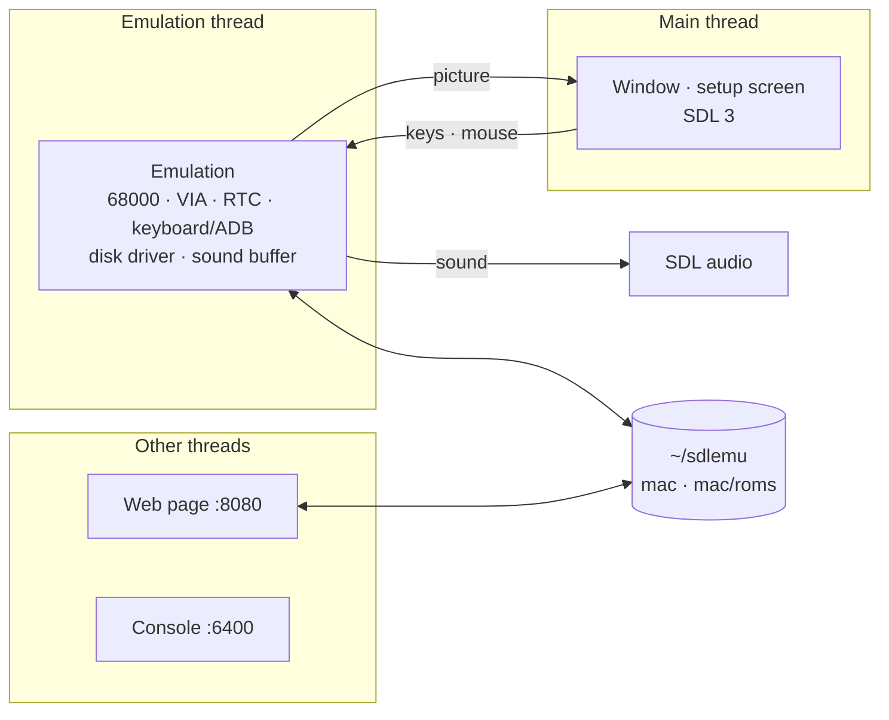

<h1 align="center">sdlmac</h1>

<p align="center">
  <b>A Macintosh Plus, SE or Classic in an SDL 3 window on Linux or macOS.</b><br>
  68000, up to 4 MB, classic Mac OS, disk images of any size.
</p>

<p align="center">
  
  
  
  
  
  
</p>

<p align="center">
  <b>Work in progress:</b> not everything has been tested, and games and demos may or may not
  work satisfactorily.
</p>

<p align="center">
  
  <br>
  <sub>The Mac Plus asking for a system disk, on the Pi.</sub>
</p>

sdlmac runs [esp32mac](https://github.com/rlucencic/esp32mac)'s Mac on 64-bit Linux (arm64 and amd64) and Apple Silicon macOS. SDL 3 provides the window, sound and input. The machine is the
same code as on the ESP32 boards: esp32mac's platform-independent core and
[esp32emu](https://github.com/rlucencic/esp32emu)'s CPU core, on
[sdlemu](https://github.com/rlucencic/sdlemu), the family's desktop runtime: a setup
screen in the window, sound, the host's keyboard and mouse, a web page on your network and a
console.

It belongs to the SDL desktop family of the ESP32 emulators:
[sdlzx](https://github.com/rlucencic/sdlzx) (ZX Spectrum),
[sdlcpc](https://github.com/rlucencic/sdlcpc) (Amstrad CPC),
[sdlcbm](https://github.com/rlucencic/sdlcbm) (Commodore 64 and 128),
[sdlcoco](https://github.com/rlucencic/sdlcoco) (Tandy Color Computer 2 and 3),
[sdlgs](https://github.com/rlucencic/sdlgs) (Apple IIGS),
[sdlmsx](https://github.com/rlucencic/sdlmsx) (MSX1 and MSX2),
[sdlxl](https://github.com/rlucencic/sdlxl) (Atari 800XL and 130XE),
[sdlste](https://github.com/rlucencic/sdlste) (Atari STE),
[sdlpc](https://github.com/rlucencic/sdlpc) (IBM PC/XT and PC/AT),
[sdlmac2](https://github.com/rlucencic/sdlmac2) (Macintosh LC and II),
[sdlmac3](https://github.com/rlucencic/sdlmac3) (Macintosh LC II and LC III),
[sdlarc](https://github.com/rlucencic/sdlarc) (Acorn Archimedes),
[sdlami](https://github.com/rlucencic/sdlami) (Amiga 500, 2000, 600, 1200).

## Features

**The machine**
- 68000 at 7.83 MHz ([Musashi](https://github.com/kstenerud/Musashi) core), full speed on the Pi.
  Speedometer 3.23 rates it at 1.3 times a Mac Classic: the emulated CPU
  never waits for the video and sound circuits the way the real one does
- Macintosh Plus, SE or Classic, chosen on the setup screen (from the ROMs you have)
- 1, 2 or 4 MB of RAM
- VIA with its timers, real-time clock with parameter RAM (set from the
  Pi's time, settings kept across power-offs), the sound buffer
- Plus keyboard protocol, or ADB keyboard and mouse on the SE and Classic

**Disks**
- **Three drives** for disk images of any size: 400K/800K/1.4M floppies and
  hard disks up to 2 GB, through a fast replacement of the Mac's disk driver
- Tested with System 7.5.3 on all three models
- Raw images (`.dsk`, `.img`, `.hfv`), Disk Copy 4.2 images (`.image`), and
  partitioned hard disk and CD images (`.hda`, `.iso`, `.toast`)
- **Mac archives straight from the old download sites**: StuffIt (`.sit`,
  `.sea`, 1.5 to 5.x), Compact Pro (`.cpt`), BinHex (`.hqx`) and MacBinary
  (`.bin`) files dropped on the web page are unpacked in your browser and put
  on a disk image of their own, ready to insert (disk images inside an
  archive are used as they are)
- **New blank disks** from the setup screen or the web page (800 KB to 500 MB);
  the Mac offers to initialise them
- Disks inserted while the Mac runs appear on the desktop; ejecting one on
  the Mac frees the drive

**Around it**
- **A window** of its own on the Pi's desktop (X11 or Wayland), resizable, full screen
  with Ctrl+Alt+F; the picture in the machine's shape, smoothly scaled
- **Setup screen** in the window, first thing at start and any time with Ctrl+Alt+M:
  model, memory, the sound's volume, the drives and their images (insert, eject, new
  blank ones), Start / Back / Restart, Reset
- **The Pi's keyboard and mouse**: keys by position, as the boards' Bluetooth keyboards;
  a click in the window gives the mouse to the machine, Ctrl+Alt+G takes it back
- **Web page** at `http://<the Pi>:8080/`: drop images (or ZIP files) onto it, insert
  them, make blank ones, and watch the machine and its drives live
- **Sound** through SDL (PipeWire, PulseAudio or ALSA), the machine paced by the clock
- **Console** on the terminal and on `127.0.0.1:6400`: keys, typing, drives, screenshots

<p align="center">
  
  <br><sub>The setup screen in the window, before the Mac starts</sub>
</p>

## Getting started

### 1. What you need

- 64-bit Linux (including Raspberry Pi 5) or Apple Silicon macOS with SDL 3.2 or newer. See [desktop build dependencies](https://github.com/rlucencic/sdlemu#building).
- [esp32emu](https://github.com/rlucencic/esp32emu), [sdlemu](https://github.com/rlucencic/sdlemu)
  and [esp32mac](https://github.com/rlucencic/esp32mac), cloned next to this project
- The ROMs (below)

### 2. Build

```sh
git clone https://github.com/rlucencic/esp32emu.git
git clone https://github.com/rlucencic/sdlemu.git
git clone https://github.com/rlucencic/esp32mac.git
git clone https://github.com/rlucencic/sdlmac.git && cd sdlmac
cmake -S . -B build -G Ninja && cmake --build build
```

### 3. ROMs

The Mac Plus's (128 KB), the SE's (256 KB) or the Classic's (512 KB) in the
data folder's `mac/roms/` (`~/sdlemu/mac/roms`), under any name (esp32mac's
are `plus.rom`, `se.rom`, `classic.rom`): it is found by its checksum. Not
part of this repository.

### 4. First start

1. `build/sdlmac`: the setup screen opens in a window.
2. Choose the model and click **Start**.
3. Put images into `~/sdlemu/mac/`, drop them on the window or the web page, and
   insert them on the setup screen's **Disks** page.

## Using it

| To | Do |
|---|---|
| Get back to the setup screen | Ctrl+Alt+M (the machine waits meanwhile) |
| Full screen | Ctrl+Alt+F |
| Give the mouse to the machine, take it back | A click in the window; Ctrl+Alt+G |
| Run as fast as it goes (warp) | Ctrl+Alt+W, again for real speed |
| Take a screenshot | Ctrl+Alt+S (into `~/sdlemu/screenshots`), or the console's `s` |
| Insert an image | The setup screen's **Disks** page, drop it on the window or the web page, or name it on the command line: `build/sdlmac System6.dsk` |
| Start straight into the machine | `build/sdlmac -S`, with the setup screen's rows as `--choice`: `build/sdlmac -S --choice "Model=Mac SE"` |
| Show the window on another computer | Log in with `ssh -C -Y <the Pi>` and start it there: fine for still pictures; games want the Pi's own monitor |

Images live in `~/sdlemu/mac/` (sdlmac2's and sdlmac3's too), settings in
`~/.config/sdlemu/settings.ini`; the inserted images are remembered across starts.
`build/sdlmac --help` lists the options.

Keyboard: Command is the Windows/⌘ key, Option is Alt, Backspace is Delete,
Insert is Help. The Plus keyboard has no Control, Escape or function keys.

## How it works



- **[esp32mac](https://github.com/rlucencic/esp32mac)'s `components/macintosh`**: the Mac,
  platform independent: the same code runs on the ESP32 boards.
- **`src/`**: the glue, esp32mac's `main/main.c` ported: memory, ROMs, settings, keyboard map,
  drives and status.
- **[sdlemu](https://github.com/rlucencic/sdlemu)**: the window, the setup screen, sound,
  input, the web page, the console, the data folder and the settings.
- **[esp32emu](https://github.com/rlucencic/esp32emu)**: the CPU core (Musashi 68000).

## Development

```sh
../sdlemu/tools/pi.sh sdlmac build        # from another computer: sync to the Pi, build there
../sdlemu/tools/pi.sh sdlmac run          # its window on this computer (ssh -C -Y)
../sdlemu/tools/pi.sh sdlmac headless     # no window: drive it through the console
../sdlemu/tools/console.sh i 's /tmp/shot.png'
```

`CLAUDE.md` has the details: the layout, how it was ported, the checks; esp32mac's own
`CLAUDE.md` has the machine's.

## Limitations

- Checked on the Pi through its console and screenshots: the Plus, SE and Classic at full speed to their disk icon. Not yet by hand
  in the window, with the sound heard, or with much software.
- Over X forwarding (`ssh -Y`) every changed picture crosses the network: 8 to 15 a second.
- No serial ports, printer, AppleTalk or SCSI devices (disk images take
  their place).
- Disk images are presented through the floppy driver: copy-protected
  originals that talk to the floppy hardware directly don't work.
- Black and white 512×342 only (no Mac II or colour).
- System 7.5.3 refuses the Plus when started from its floppy set (Apple's
  floppy install set doesn't support it); the System on the 7.5.3 CD image,
  or System 6, works.

## Credits

- [Musashi](https://github.com/kstenerud/Musashi) by Karl Stenerud (MIT
  licence), via Matt Evans' [fork](https://github.com/evansm7/Musashi) for
  embedded use
- [Mini vMac](https://www.gryphel.com/c/minivmac/) and Matt Evans'
  [umac](https://github.com/evansm7/umac), the references for how these Macs
  behave and how a paravirtual disk driver fits in
- [The Unarchiver](https://theunarchiver.com)'s XADMaster by Dag Ågren (LGPL), the
  reference for the StuffIt and Compact Pro formats, and Elliot Nunn's
  [machfs](https://github.com/elliotnunn/machfs) (MIT) for the HFS name order
- [SDL](https://libsdl.org) 3 for the window, the sound and the input

## Licence

[MIT](LICENSE).

Apple, Macintosh and Mac are trademarks of Apple Inc. This project contains
no Apple code; you need your own ROM images and system software.
